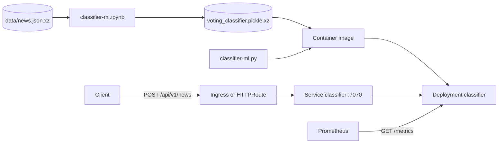

# Architecture

The model and the service live in one repository and ship as one container image. CI trains the
model from the dataset in the commit it builds, copies it into the image beside the Flask
application, and publishes the image to Docker Hub. Kubernetes runs that image unchanged.

## Training

`classifier-ml.ipynb` reads the dataset, cleans it, fits a scikit-learn pipeline and writes the
fitted pipeline to `data/voting_classifier.pickle.xz`. Git does not track the model file. CI
executes the notebook on every build, inside the Jupyter data science image, so each image
carries a model trained from the dataset in its own commit. [Training the model](model.md)
describes the pipeline.

## Image

The `Dockerfile` has two stages. The first installs the locked runtime dependencies from
`uv.lock` into a virtual environment with uv. The second copies that environment, the two Python
files and the model into a slim Python image, and runs the service as `nobody` on port 7070.

## Service

`classifier-ml.py` loads the model once at start and holds it in memory. It answers
classification requests from that copy, exposes Prometheus metrics, and can replace the copy by
retraining on posted data. A replacement lasts until the process exits and stays local to the
replica that received it. [API reference](api.md) lists the endpoints.

## Kubernetes

The manifests under `deployment/` define a Deployment and a ClusterIP Service. Two overlays
route traffic to the Service, one through an ingress-nginx Ingress and one through a Gateway API
HTTPRoute. The pod template carries Prometheus scrape annotations for port 7070.
[Deploying on Kubernetes](deploying.md) covers each overlay.
